  

  
  
  

 

I design and build **systems that scale** and bring **machine learning into real products**.
I care about clear architecture, honest trade-offs, and software that keeps working long after launch.

- **System architecture:** service boundaries, data models, and APIs that stay fast as products grow
- **ML integration:** taking models from notebooks to production, with pipelines, serving, and monitoring
- **Product engineering:** shipping full-stack products end to end

 

## ✦ Building

  

  
  

 

## ✦ Toolkit

<b>LANGUAGES & FRONTEND</b>  
  

<b>BACKEND & DATA</b>  
  

<b>AI / ML & CLOUD</b>  
  

<b>WORKFLOW</b>  
  

 

## ✦ Code & Activity

  

  

 

  Simple systems scale. Clever ones break.

